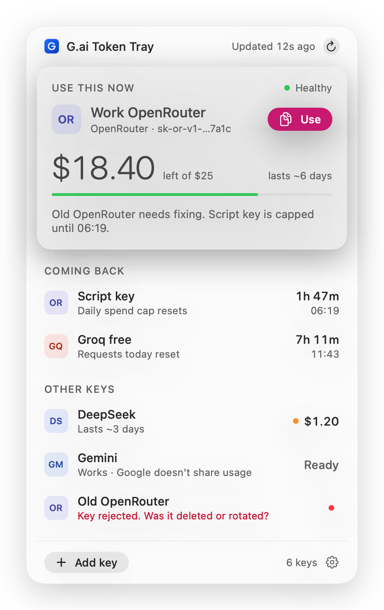
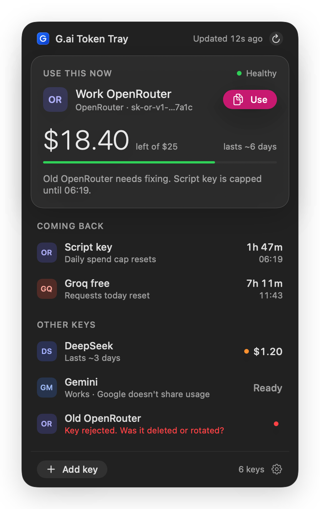
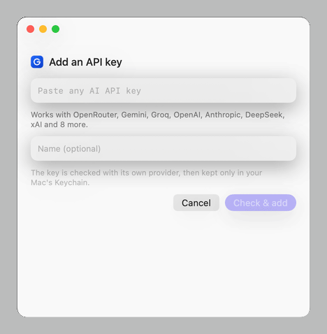
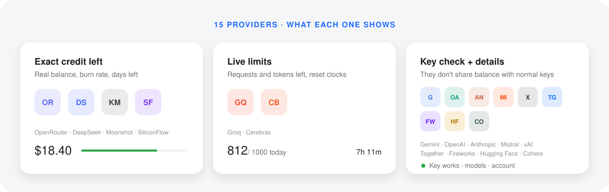

<div align="center">


# G.ai Token Tray

**Which AI key should I use right now?**
A tiny Mac menu bar app by **GauthamWho**.


<br><br>



</div>

---

## 😩 → 😌 The problem it solves



> You use free and paid AI keys. One runs out mid-task. Which one still has credit? When does the other come back?
> **G.ai Token Tray answers that in one glance, from your menu bar.**

---

## 👀 What you see

<table>
<tr>
<td align="center"><br><sub>Light</sub></td>
<td align="center"><br><sub>Dark</sub></td>
</tr>
</table>

| Look at | It means |
|:--|:--|
| 🟩 **Best right now** | Use this key. Big number = credit or requests left. |
| ⏱ **Coming back** | A key that's paused, and the countdown until it works again. |
| 🟠 dot | Running low. |
| 🔴 dot / red line | Broken or empty. Fix or remove it. |
| **Use** button | Copies the key (Touch ID). Clipboard clears after 60 s. |

---

## ⚙️ How it works



---

## 📦 Install (3 steps)



```bash
git clone https://github.com/GauthamWho/G.ai-Token-Tray.git
```

```bash
cd G.ai-Token-Tray && ./build.sh --open
```

Needs a Mac on **macOS 14+** with **Xcode** installed. Liquid Glass shows on macOS 26.
The **G** appears in your menu bar, top right. 🎉

---

## 🔑 Add a key

<div align="center">

</div>

1. Click **G** → **+ Add key**
2. Paste your key → **Check & add**
3. Done. Credit, limits and resets appear.

Unfamiliar key format? You pick the provider, or tap **Test with all providers**. Your key never goes anywhere you didn't choose.

---

## 🌐 Works with 15 providers



---

## 🛡️ Private by design

| | |
|:--:|:--|
| 🔐 | Keys live only in your Mac's **Keychain**. Never in plain files. |
| 🎯 | A key goes **only to its own provider**. Nothing else without your OK. |
| 👆 | Copying a key needs **Touch ID** or your password. |
| 🚫 | No accounts, no tracking, no servers of mine. |
| ✅ | Checked with Cloudflare's [security-audit skill](https://github.com/cloudflare/security-audit-skill). Its one finding is fixed. |

---

## ✨ Feels premium

Liquid Glass panel · cursor-following light · a hero card that leans toward your pointer · rolling numbers · live countdowns · readable candy-pink accent shared with [Gautham's Clipboard](https://github.com/GauthamWho/gs-clipboard) · light and dark mode · respects **Reduce Motion**.

**Keyboard:** ↩ copies the recommended key (Touch ID) · ⌘R checks all keys · ⌘N adds a key · ⌘Q quits.

---

## 💡 Why I built this

I kept hitting "free usage limit reached" in the middle of work, then guessing which key still had credit. I wanted one glance that tells me what to use, without opening five dashboards. So I built it.

**— GauthamWho**

---

## 🙋 Ideas? Problems? Tell me

<div align="center">

[](https://github.com/GauthamWho/G.ai-Token-Tray/issues/new)
&nbsp;
[](https://github.com/GauthamWho)

</div>

---

## © License

**Free to use. Not free to sell or copy.**

| ✅ You can | ❌ You can't |
|:--|:--|
| Download, build and use it, free | Sell it or charge for it |
| Read the code | Re-upload or redistribute it |
| Share the link to this repo | Build your own product on this code |

Copyright © 2026 **GauthamWho**. All rights reserved. Full terms: [LICENSE](LICENSE).

<details>
<summary>For developers</summary>

```bash
.build/release/TokenTray --selftest
```

Design system: [DESIGN.md](DESIGN.md) · style sheet: `tokentray-design/stylesheet.html` · product notes: [PRODUCT.md](PRODUCT.md).
</details>
